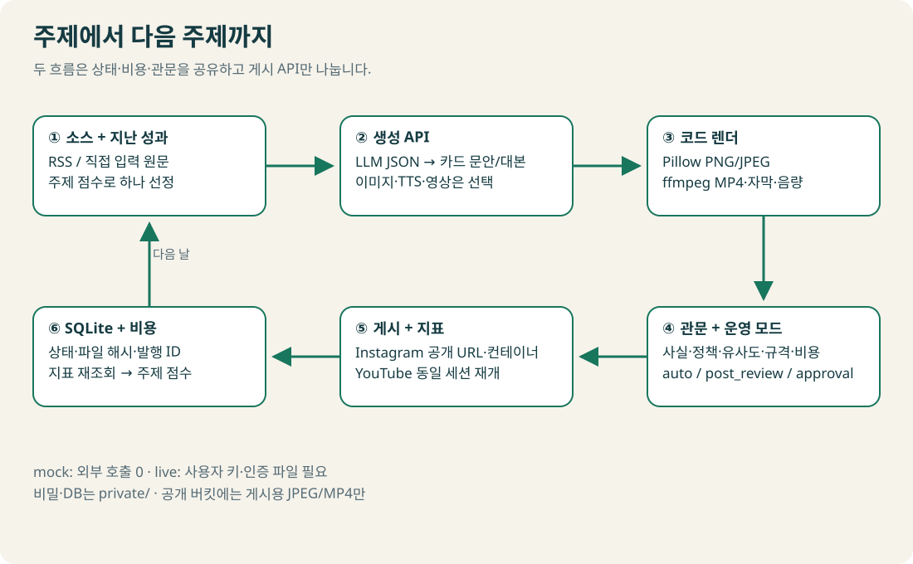
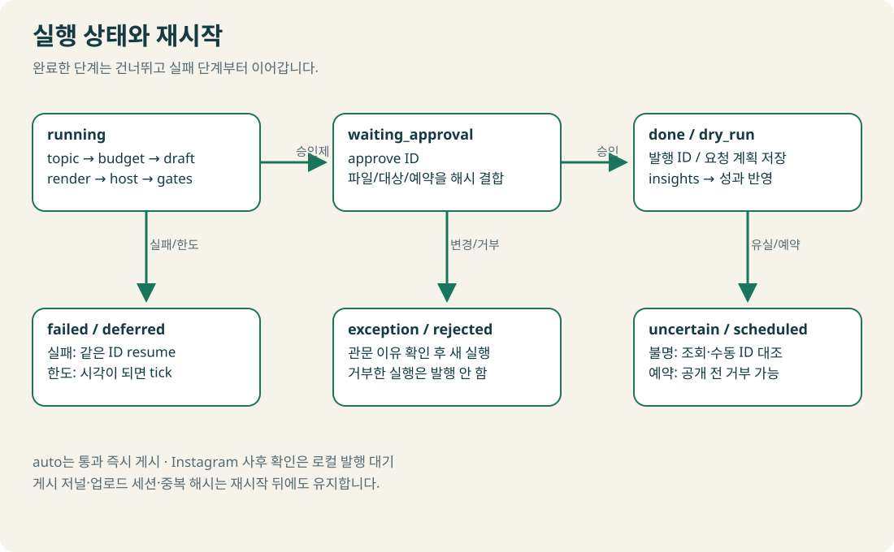
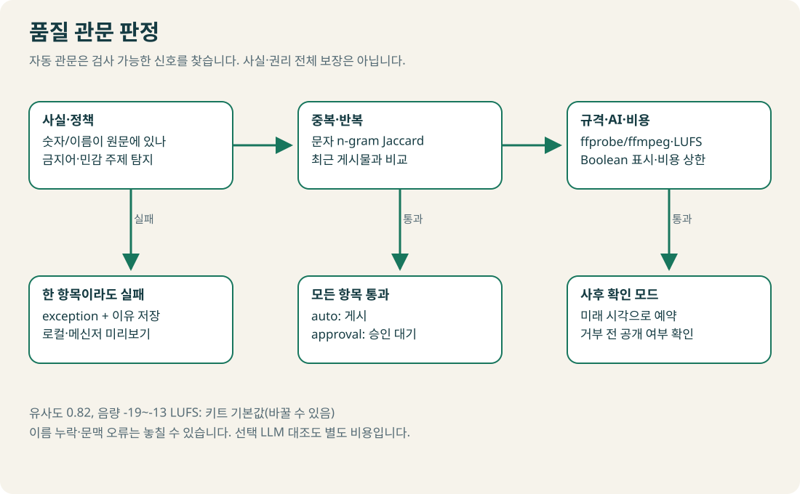
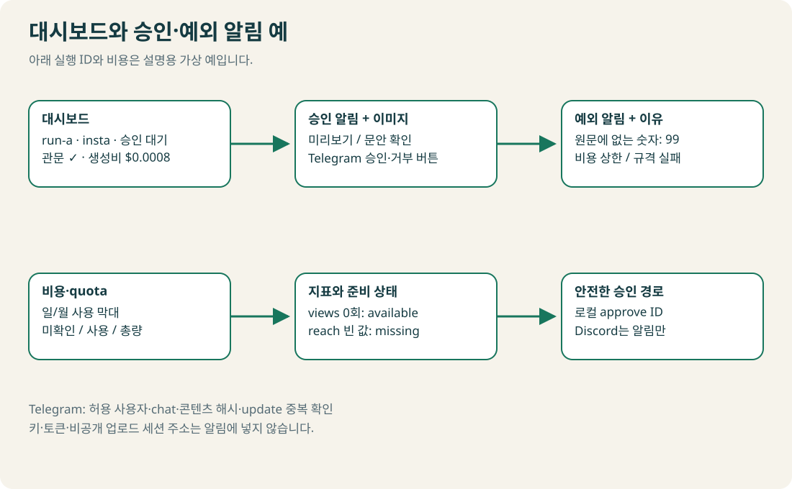

# API로 카드·쇼츠를 자동 제작하기

**키 없이 카드와 쇼츠를 끝까지 만든 뒤, 인증을 하나씩 추가해 실제 운영으로 바꿔요.** Python 3.11 이상이 필요해요. 터미널은 아래 명령을 입력하는 창이에요. 하린의 가상 계정 「출근길 3분 생활 뉴스」와 도윤의 가상 채널 「자취생 10분 생존법」을 예제로 써요. 문안은 직접 작성한 예시이고, 소리는 연습용 신호음이에요.

2026년 10월 조사 기준. [조사·구현 근거](docs/sources.md) · [그림 모음](docs/figures.html) · [미리 만든 결과](samples/README.md).

<picture><source media="(prefers-color-scheme: dark)" srcset="docs/figures/system-dark.svg"></picture>

## 1. 설치

저장소를 내려받고 `auto-kit` 폴더를 터미널에서 열어요. 이 폴더만 복사해도 실행돼요. 가상환경은 이 키트에서만 사용할 Python 도구함이에요. 시스템 패키지 관리자는 사용하지 않아요. ffmpeg도 pip 바이너리로 설치해요.

Windows PowerShell:

```powershell
py -3.11 -m venv .venv
.\.venv\Scripts\python.exe -m pip install --only-binary=:all: -r requirements-dev.txt
Set-Alias python "$PWD\.venv\Scripts\python.exe"
```

이렇게 보이면 성공: `.venv` 폴더가 생기고 설치가 오류 없이 끝나요. 별칭은 현재 PowerShell 창에서만 적용돼요. 새 창에서는 마지막 줄을 다시 실행해요. 실행 정책을 바꿀 필요는 없어요.

macOS 터미널:

```bash
python3.11 -m venv .venv
source .venv/bin/activate
python -m pip install --only-binary=:all: -r requirements-dev.txt
```

설치한 버전이 3.12 이상이면 첫 명령의 `python3.11`을 그 버전의 실행 이름으로 바꿔요.

이렇게 보이면 성공: 프롬프트에 `(.venv)`가 보이고 설치가 끝나요. 다음 명령의 `python`은 이 가상환경을 가리켜요.

두 OS 공통:

```bash
python doctor.py
python -m pytest -q
```

이렇게 보이면 성공: `Python 3.11`(또는 설치한 상위 버전), `mock 준비 완료`, `pip ffmpeg 실행 가능`, pytest 마지막에 `passed`가 보여요. doctor는 기본으로 인터넷에 연결하지 않아요. ffprobe가 없으면 pip ffmpeg의 검사기로 대체해요.

## 2. mock 전체 실행

먼저 품질 관문이 통과하면 자동으로 드라이런을 끝내 봐요. **이 명령은 생성 API·호스팅·게시 API에 연결하지 않아요.**

```bash
python pipeline.py run --flow insta --provider mock --mode auto
python pipeline.py run --flow shorts --provider mock --mode auto
python pipeline.py status
```

이렇게 보이면 성공: 두 실행에 `dry_run`이 보여요. 각 명령 첫 줄의 12자리 실행 ID와 미리보기 경로를 확인해요. `private/state/실행ID/preview.html`을 브라우저로 열면 카드 또는 MP4가 보여요. 인스타는 **「청년 지원금, 신청 전 확인할 3가지」 카드 5장**, 쇼츠는 **「월급날 10분, 돈을 네 칸으로 나누기」 36초 영상**이에요. 쇼츠의 소리는 설명용 신호음이며 실제 낭독이 아니에요. 제목의 10분은 메모 활동 시간이에요.

| 남는 파일 | 확인할 내용 |
|---|---|
| `cards/card-*.png`, `*.jpg` | 코드 템플릿 카드. 게시에는 JPEG 사용 |
| `short.mp4`, `subtitles.srt` | 세로 영상·자막. 장면 시간에 자막 배분 |
| `draft.json`, `config.json` | 이번 실행에 고정한 문안·설정 |
| `gates.json` | 검사별 통과와 실패 이유 |
| `request-plan.json` | 인증 값을 가린 드라이런 요청 내용 |
| `insights.csv` | 단위·수집일·missing을 구분한 가상 지표 |
| `private/state/dashboard.html` | 실행·관문·비용 막대·지표 |
| `state.sqlite`, `execution.log` | 단계·중복 해시·비용·안전한 실행 로그 |

같은 소스는 다시 고르지 않아요. 예제에는 흐름별로 주제가 하나씩 들어 있어요. 연습을 새로 시작하려면 기존 상태를 지우지 말고 새 `--state private/새연습` 경로를 사용해요.

## 3. 승인·재개·거부 연습

처음 운영에는 기본값 `approval`을 사용해요. `RUN_ID`는 아래 첫 명령이 출력한 실제 ID로 바꿔요.

```bash
python pipeline.py run --flow insta --provider mock --state private/review-demo
```

이렇게 보이면 성공: `waiting_approval`. 미리보기·원문·문안·AI 표시를 확인해요.

```bash
python pipeline.py approve RUN_ID --state private/review-demo
python pipeline.py resume RUN_ID --state private/review-demo
```

이렇게 보이면 성공: 승인 명령은 대기 상태를 유지하며 승인 파일을 만들어요. 이어서 resume에 `dry_run`이 보여요. 실제 게시 명령에는 추가로 `--live`가 필요해요. **이미 만든 드라이런을 live로 승격할 수는 없어요.**

`failed`는 같은 ID로 resume하면 완료한 단계를 건너뛰어요. 파일·문안·대상·공개범위·AI 표시·예약 시각이 바뀌면 승인이 무효예요. 수정할 때는 소스/설정을 고쳐 새 실행을 만들어요. `exception`은 자동 관문에 걸린 상태라 approve로 우회하지 못해요. 만료된 승인은 다시 승인 대기로 돌아와요.

사후 확인 연습:

```bash
python pipeline.py run --flow insta --provider mock --mode post_review --state private/schedule-demo
python pipeline.py reject RUN_ID --state private/schedule-demo
```

이렇게 보이면 성공: 먼저 `scheduled`, 거부 후 `rejected`. 이번에 출력된 새 ID를 사용해요.

| mode | 인스타 | 쇼츠 |
|---|---|---|
| `auto` | 관문 통과 후 게시 | 관문 통과 후 명시한 공개 범위로 업로드 |
| `post_review` | 기본 2시간 로컬 대기, tick이 시각 도달 후 발행 | private+미래 publishAt 업로드, 공개 전 거부 가능 |
| `approval` | approve 후 resume | approve 후 resume, 기본 private |

쇼츠 예약 거부는 업로드한 예약 영상을 삭제해요. `youtube.force-ssl` 권한이 필요해요. 공개 시각이 지났거나 취소 응답을 확인하지 못하면 취소 완료로 표시하지 않아요. Discord incoming webhook은 알림만 제공해요.

<picture><source media="(prefers-color-scheme: dark)" srcset="docs/figures/states-dark.svg"></picture>

## 4. 설정과 실제 생성 API 전환

설정 파일 JSON은 이름과 값을 저장하는 텍스트예요. Windows는 `Copy-Item config.example.json config.json`, macOS는 `cp config.example.json config.json`을 실행해 복사해요. 같은 방법으로 `.env.example`을 `.env`로 복사해요. 이렇게 보이면 성공: 두 파일이 생겨요. `.env`에는 사용자 본인의 키만 넣어요. 값은 Git에 넣지 않아요.

카드·영상에 표시할 이름은 `flows.insta.account_name`과 `flows.shorts.channel_name`에서 바꿔요. 각 흐름의 `creator_name`은 영상의 「이름의 연습」, `preview_speaker`는 미리보기 안내의 발화자예요. 미리보기 제목에도 해당 계정·채널명이 들어가요. mock과 실제 생성에 같은 설정을 써요. 이전 설정 파일에는 `config.example.json`의 `flows` 항목을 추가하세요. 수정한 설정은 새 실행부터 적용돼요. 실행 ID로 재개하면 그 실행에 저장한 설정을 유지해요.

실제 생성·호스팅·게시가 필요한 실행에만 `--live`를 붙여요. `approval`로 시작하면 생성·검사 후 게시 직전 멈춰요. `--live` 실행 전에는 해당 플랫폼 인증 파일도 필요해요. 키를 하나씩 설정할 때 아래 명령으로 빠진 항목을 확인해요.

```bash
python doctor.py --config config.json --live --flow insta
```

이렇게 보이면 성공: 빠진 값은 이름과 할 일이 표시돼요. 모두 준비되면 `[error]`가 없어요. 이 명령도 기본은 로컬 설정 검사예요.

| 선택 | config.json | .env |
|---|---|---|
| LLM 한 개부터 | `providers.llm`: `openai` / `gemini` / `anthropic` | 해당 `*_API_KEY` |
| 카드 코드 템플릿 | `media.image_api: false` | 필요 없음 |
| 이미지 생성 | `media.image_api: true`, `providers.image: "gemini"` | `GEMINI_API_KEY` |
| 본인 녹음 | `media.recording`: 로컬 WAV/MP3 절대경로 또는 키트 상대경로 | 필요 없음 |
| Google 음성 | `media.recording: null`, `providers.tts: "google"` | `GOOGLE_TTS_API_KEY` |
| 보유 사진·클립 | `media.scenes_dir`: 폴더 경로, 장면 수와 파일 수 일치 | 필요 없음 |
| 영상 생성 선택 | `media.video_api: true`, `providers.video: "runway"`, `providers.image: "gemini"` | `RUNWAY_API_KEY`, `GEMINI_API_KEY` |
| 인스타 모션 릴스 | `instagram.format: "reel"`, 실제 TTS 또는 본인 녹음 | 음성 경로에 따라 설정 |
| 선택 LLM 원문 대조 | `providers.llm_check: true`, `check_llm` 공급자·모델 | 두 번째 모델 비용도 기록 |

처음에는 LLM 한 개·코드 카드 또는 보유 소재·본인 녹음만 연결해요. 모델 이름은 `models`, 조사 단가는 `providers/prices.json`에서 바꿔요. 종료된 모델을 기본값으로 사용하지 않아요. JSON 스키마 오류는 정한 횟수만 재시도해요. 미디어 생성은 같은 작업 ID를 보존하고 자동으로 새 작업을 만들지 않아요.

### 원문·RSS·권리

예제 소스 대신 `private/my-sources.json`에 다음처럼 본인 원문을 저장해요. `sources.files`를 이 경로로 바꿔요. `text`는 실제 내용으로 바꿔야 해요. 동봉 예시는 실제 제도명·금액·마감일을 넣지 않았어요. 실제 생활 뉴스는 본인이 확인한 공고로 바꿔요. `example.invalid`는 실제 출처를 채울 자리예요. 동봉 예시의 `synthetic: true`와 `rights_reviewed: false`는 live 실행을 차단해요.

소스의 `flow`를 `insta` 또는 `shorts`로 쓰면 해당 흐름에서만 골라요. 생략한 사용자 소스는 두 흐름에서 사용할 수 있어요. mock은 원문의 첫 줄을 훅으로, 다음 네 줄의 `항목: 설명`을 장면으로 옮겨요. 실제 LLM 요약은 사용자 API 연결 후 실행해요.

```json
[{"title":"직접 확인한 주제","text":"여기에 실제 원문을 넣어요.","url":"https://example.org/original","entities":[],"synthetic":false,"rights_reviewed":true,"category":"내 주제"}]
```

RSS는 `sources.rss`에 주소 문자열 또는 아래 객체를 넣어요. 문자열의 기본은 권리 확인 보류예요. `rights_reviewed: true`는 직접 사용권과 운영 기준을 확인한 소스에만 설정해요. RSS의 공개 여부가 이미지·문장 전체의 재사용 권리를 뜻하지는 않아요.

```json
{"url":"https://example.org/feed.xml","rights_reviewed":true,"category":"내 주제","entities":["원문 기관명"]}
```

드라이런은 RSS도 내려받은 로컬 XML로 지정해요. 동봉 피드를 연습하려면 `sources.files`를 `[]`로, `sources.rss`를 아래 목록으로 바꿔요. JSON 직접 입력과 같은 예시 문안이에요.

```json
[
  {"url":"sources/insta-feed.xml","flow":"insta","synthetic":true,"rights_reviewed":false,"category":"생활 뉴스"},
  {"url":"sources/shorts-feed.xml","flow":"shorts","synthetic":true,"rights_reviewed":false,"category":"자취 생활"}
]
```

```bash
python pipeline.py run --flow insta --provider mock --mode auto --config config.json --state private/rss-demo
python pipeline.py run --flow shorts --provider mock --mode auto --config config.json --state private/rss-demo
```

이렇게 보이면 성공: 두 실행이 `dry_run`으로 끝나고 같은 카드·쇼츠가 만들어져요.

주제 점수는 소스 순서 점수 `1/(순서+1)`에 지난 views/engagedViews의 `log(1+값)` 평균×가중치를 더해요. 성과 값이 없는 주제의 성과 점수는 0이에요. 같은 흐름의 최근 게시 지표를 사용해요.

### 비용 상한

`budget.daily_usd`와 `monthly_usd`를 먼저 정해요. 키트는 UTC 일/월 상한을 사용해요. 생성 전에 장면 최대 수·출력 상한·재시도를 포함한 실행 최대비를 예약하고, 호출 비용을 그 예약 안에서 기록해요. 실제 usage를 받으면 정산하고 남은 실행 예약을 풀어요. usage 누락·응답 유실은 최대비를 유지해요. 무료량이 남아 있다고 자동 추정하지 않아요.

실패 실행을 더 이상 재개하지 않으면 `reject RUN_ID`로 거부해 사용하지 않은 실행 예약을 해제해요. 이미 호출한 비용과 결과 불명 비용은 해제하지 않아요.

공급자 콘솔의 강제 지출 상한도 직접 설정한 뒤 `provider_hard_cap_confirmed: true`로 바꿔요. Cloud 예산 알림은 자동 중지가 아니에요. 이미지·영상 추가 시 실행 최대비가 일 상한보다 클 수 있어요. 상한을 무작정 올리기 전에 생성 구성을 줄여요. [공급자별 근거](docs/sources.md)

<picture><source media="(prefers-color-scheme: dark)" srcset="docs/figures/gates-dark.svg"></picture>

사실 대조 예: 원문의 **확인할 3가지**는 통과해요. 원문에 없는 **지원금 99만원**을 문안에 추가하면 `원문에 없는 숫자: 99`로 실패해요. 실패 문안은 게시하지 않는 테스트 전용이에요.

```bash
python -m pytest -q tests/test_core.py -k example_fact
```

이렇게 보이면 성공: 두 흐름의 통과·숫자 오류 검사가 `4 passed`로 끝나요.

> 확인할 점: 숫자·이름의 문자열 대조는 문맥의 참거짓과 모든 한국어 인명을 판별하지 못해요. 유사도·음량·문안 길이 기준은 **키트 기본값(바꿀 수 있음)**이에요. ffmpeg가 실제 규격·LUFS를 측정하며 무음은 관문을 통과하지 못해요. LLM 대조도 오판할 수 있어요. 최초 몇 편의 원문·권리·자막·발음을 직접 확인하며 기준을 맞추세요.

## 5. Instagram 연결

이 키트는 본인 프로페셔널 계정의 **Instagram Login** 경로를 사용해요. Facebook 페이지가 필요 없는 경로예요. 신규 고객 서비스 권장인 Unified Login과 토큰·호스트·scope를 섞지 않아요. [인증 준비 근거](../research-advanced/instagram-auth.md)

1. 본인 계정 토큰·숫자 ID를 발급받아요. `.env`의 `IG_USER_ID`, `IG_ACCESS_TOKEN`, `IG_TOKEN_ISSUED_AT`, `IG_TOKEN_EXPIRES_AT`을 채워요. 시각은 `2026-10-26T09:00:00+09:00`처럼 오프셋까지 써요.
2. 게시 권한과 분석 권한을 확인해요. `instagram_business_basic`, `instagram_business_content_publish`, 분석에는 `instagram_business_manage_insights`가 필요해요.
3. 공개 URL 호스팅을 고르고 `instagram.is_ai_generated`를 최종 콘텐츠에 맞게 판단해요. 캐러셀은 부모에만 전송해요.

| 호스팅 | 설정 | 조건 |
|---|---|---|
| `local` | 기본값 | 파일 복사·가상 URL, 드라이런 전용 |
| `pages` | 별도 교육용 `owner/repo`, 미디어 브랜치, Pages 기본 URL, `PAGES_TOKEN` | 미리 만든 브랜치를 Pages로 배포. 작은 비민감 교육 미디어용 |
| `r2` | 비공개 S3 endpoint, 공개 미디어 bucket·base_url, R2 키 | Standard 무료 범위·초과 요금 확인. 공개 미디어와 비공개 상태 bucket 분리 |

두 실제 어댑터 모두 JPEG/MP4만 올려요. 인증 없이 GET한 파일의 MIME·SHA256까지 확인해요. Pages가 아직 배포 중이면 host 단계에서 멈춰요. 배포 후 같은 ID로 resume해요. 공개 호스팅은 승인 전에 이뤄지므로 공개해도 되는 자료만 사용해요. [호스팅 조건](../research-advanced/execution-hosting.md)

```bash
python doctor.py --config config.json --live --flow insta --check-remote
python pipeline.py run --flow insta --config config.json --live
```

이렇게 보이면 성공: doctor가 실제 사용량/총량을 출력하고, 실행은 `waiting_approval`에서 멈춰요. doctor의 원격 옵션은 계정 한도만 읽고 게시하지 않아요. 위 run은 사용자 생성·호스팅 API를 실제 호출할 수 있어요.

```bash
python pipeline.py approve RUN_ID
python pipeline.py resume RUN_ID --live
```

이렇게 보이면 성공: `done`과 게시 ID가 실행 기록에 남아요. 계정에서 공개 상태·라벨을 직접 확인해요. 컨테이너 ID와 게시 ID는 달라요. 한도를 읽지 못하면 임의 100을 적용하지 않고 `deferred`로 연기해요.

`uncertain`이면 새 실행을 만들지 말고 같은 ID를 resume해 기존 컨테이너를 조회해요. 이미 게시됐는데 게시 ID만 없으면 계정에서 기존 ID를 확인한 뒤 대조해요.

```bash
python pipeline.py reconcile RUN_ID --media-id EXISTING_MEDIA_ID --live
```

이렇게 보이면 성공: 기존 계정 게시물 ID·문안이 일치할 때만 완료 기록을 연결해요. 새 게시 요청은 하지 않아요.

## 6. YouTube 연결

사용자 본인이 OAuth Desktop app 파일을 받아 `private/client_secret.json`에 저장해요. OAuth는 내 채널의 정한 기능을 이 프로그램에 허용하는 동의예요.

```bash
python -m pip install --only-binary=:all: -r requirements-live.txt
python oauth_setup.py --config config.json --analytics
```

이렇게 보이면 성공: 본인 브라우저 동의 후 `OAuth 토큰 저장 완료`. 토큰은 `private/google-token.json`에 저장돼요. 업로드·실제 대상 채널 확인 권한, 옵션으로 분석 권한을 받아요. 사후 확인 또는 `publishAt` 예약에는 취소 권한도 받아요. 기존 토큰에 권한을 추가할 때는 비공개 백업으로 옮긴 뒤 다시 동의해요.

`youtube.account`가 `MINE`이면 시작할 때 실제 채널 ID로 고정해요. 업로드·취소 직전에도 같은 채널인지 확인해요. 다른 채널 토큰으로 바꾸면 기존 승인으로 게시하지 못해요.

1. 본인 녹음 또는 실제 TTS, 보유 소재 또는 생성 API를 설정해요.
2. `privacyStatus: "private"`를 유지해요. `selfDeclaredMadeForKids`와 `containsSyntheticMedia`는 서로 다른 판단이에요. 둘 다 true/false로 정해요.
3. Cloud Console에서 자신의 insert 버킷을 확인해 `quota_daily_insert`, `quota_confirmed_at`에 값·확인 시각을 기록해요. 키트 기본 일일 cap은 1이며 이 업로드 카운터는 Pacific 날짜를 사용해요. API 할당량 거절과 채널 제한도 연기 처리해요.

```bash
python doctor.py --config config.json --live --flow shorts
python pipeline.py run --flow shorts --config config.json --live
python pipeline.py approve RUN_ID
python pipeline.py resume RUN_ID --live
```

이렇게 보이면 성공: doctor에 오류가 없고 승인 전 `waiting_approval`, 승인 후 `done`이에요. 사용자 YouTube Studio에서 실제 private 영상과 처리·라벨·제한을 확인해요. 미검증 프로젝트의 비공개 잠금은 공식 안내가 상충하므로 **private 1편부터 확인**해요. OAuth 검증과 API 감사·할당량 증설은 다른 절차예요. [조사 근거](../research-advanced/youtube-api.md)

예약은 `mode: "post_review"` 또는 `youtube.publishAt`에 미래 시각을 넣어요. 예약은 private·공개 이력 없음 조건이 있어요. 예약 취소가 필요하면 OAuth에 `youtube.force-ssl`이 있어야 해요. 아동용 필드를 AI 표시 대신 사용하지 않아요. `isShorts`는 보내지 않아요.

```bash
python pipeline.py reject RUN_ID --live
```

이렇게 보이면 성공: API에서 삭제 성공을 확인한 뒤 `rejected`. 거부 시점에 이미 공개됐을 가능성은 Studio에서도 확인해요.

7일쯤 뒤 인증이 깨지면 `.env`의 `GOOGLE_OAUTH_MODE=testing`과 동의 시각을 확인해요. Testing의 7일 만료 조건을 피하려면 Production 전환·개인 사용 예외·검증 요건을 본인 프로젝트에서 확인한 뒤 다시 동의해요. 키트는 임박 시 경보하고, 유효한 refresh token으로 가능한 경우 access token을 갱신해요.

업로드 중단 시 같은 ID로 resume해요. 저장한 Location에 상태를 물어 308 Range 다음부터 재개해요. 세션 시작 결과 자체가 불명이거나 404/410으로 만료됐으면 새 insert를 만들지 않고 Studio 확인을 요구해요. 세션 URL은 공유하지 않아요.

할당량 확인 시각이 오래돼 연기됐다면 config.json에서 Console 확인 값을 갱신한 뒤 다음 명령을 써요. 게시 문안·대상·승인은 바뀌지 않아요.

```bash
python pipeline.py refresh-ops RUN_ID --config config.json
python pipeline.py resume RUN_ID --live
```

이렇게 보이면 성공: 최신 할당량 확인 기록이 연결되고 같은 업로드 상태로 재개돼요.

## 7. 알림·지표·대시보드

`.env`에 Discord webhook 또는 Telegram bot token·chat ID를 넣으면 **live 실행에서만** 미리보기와 상태를 보내요. 로컬 알림은 모든 모드에서 `notification.json`에 남아요. 웹훅 실패는 로컬 기록에 표시하며 이미 성공한 게시를 다시 실행하지 않아요.

Telegram 승인은 `TELEGRAM_ALLOWED_USER`와 `TELEGRAM_CHAT_ID`를 모두 설정해야 해요. 이 명령은 최대 25초간 새 버튼 응답을 읽고 종료해요. 봇의 webhook과 polling을 동시에 사용하지 않아요.

```bash
python pipeline.py telegram --live
```

이렇게 보이면 성공: 수신 개수가 출력돼요. 허용 사용자·chat·콘텐츠 해시가 맞는 버튼만 처리하고 update offset으로 중복을 막아요. 승인 후 resume 또는 다음 tick이 발행해요.

```bash
python pipeline.py report
python insights.py RUN_ID --state private/review-demo
```

이렇게 보이면 성공: `daily-report.json`, `dashboard.html`, 해당 실행의 `insights.csv`가 생겨요. `RUN_ID`는 3절에서 승인한 실행 ID예요. 위 insights는 `private/review-demo/실행ID/insights.csv`에 mock 지표만 저장하며 `지표 CSV 저장 완료`를 출력해요. 실계정 지표에는 `--live`와 실제 게시 ID·분석 권한이 필요해요.

```bash
python insights.py RUN_ID --live --start 2026-10-01 --end 2026-10-26
```

이렇게 보이면 성공: `지표 CSV 저장 완료`. 날짜는 실제 게시일 이후의 조회 기간으로 바꿔요. `0`은 준비된 값, 빈 값·`missing`은 아직 없거나 미지원인 값이에요. tick은 최근 게시물을 기본 7일 동안 매일 재조회해 다음 주제 점수에 반영해요. Instagram 계산 지표는 최대 48시간 지연될 수 있어요. YouTube는 요청한 지표가 모두 준비된 마지막 날짜까지 반환해요. [분석 근거](docs/sources.md)

<picture><source media="(prefers-color-scheme: dark)" srcset="docs/figures/alerts-dark.svg"></picture>

## 8. Windows·macOS·cron 예약

예약은 먼저 mock으로 등록해요. 생성기는 파일만 만들어요. 실제 등록은 출력된 설치 스크립트를 사용자가 실행할 때 이뤄져요. 15분마다 상태를 확인하며 지정한 **OS 현지 시각 이후 하루 1회** 새 콘텐츠를 만들어요. 재개·예약 발행은 매 tick마다 확인해요.

Windows PowerShell:

```powershell
python -m schedule.install --os windows --flow insta --time 09:17
```

이렇게 보이면 성공: `예약 파일 생성 완료`와 `install-insta.ps1` 경로·등록 명령이 나와요. 출력된 `& "...ps1"`을 검토해 실행하고 `Get-ScheduledTask`로 확인해요. 실제 전환은 생성 명령에 `--config config.json --live`를 붙여 새로 만들어요. 기존 작업이 있으면 같은 이름으로 덮어쓰지 않고 멈춰요. 해제 명령은 파일 끝에 있어요.

macOS:

```bash
python -m schedule.install --os macos --flow shorts --time 09:17
```

이렇게 보이면 성공: `.plist`와 `install-shorts-macos.sh`가 생겨요. 출력된 `sh ...` 명령으로 본인 LaunchAgents에 등록하고 `launchctl print`로 확인해요. bootstrap/bootout 명령도 파일에 있어요.

Linux cron:

```bash
python -m schedule.install --os cron --flow insta --time 09:17
```

이렇게 보이면 성공: 설치 `.sh`가 생겨요. 실행하면 다른 crontab 항목을 보존한 채 이 작업만 추가해요. 같은 이름이 있으면 멈춰요. `crontab -l`에 표시되고 해제는 `crontab -e`에서 해당 줄만 지워요.

수동 예약 실행 확인:

```bash
python pipeline.py tick --flow insta --provider mock --mode auto --state private/daily --daily-at 09:17
```

이렇게 보이면 성공: 현재 시각이 기준 이후면 오늘의 새 실행, 이전이면 빈 결과가 나와요. 같은 현지 날짜에는 새 실행이 한 번만 생겨요. 실패한 기존 실행은 해당 단계부터 다시 시도해요. 이 연습의 로그는 `private/daily/execution.log`에 있어요. PC의 전원·절전·로그인 사용자 조건을 실제 다음 날 확인해요.

## 9. GitHub Actions와 상태 보존

[워크플로 예시](examples/github-actions.yml)는 `examples/`에만 있어요. 사용자가 검토한 뒤 본인 저장소 `.github/workflows/`로 복사해요. 예약·수동 승인·거부·재개를 지원해요. 승인 대기는 job을 바로 종료해요.

새 runner에도 상태가 있어야 중복을 막을 수 있어요. **미디어 공개 bucket과 다른 비공개 R2 bucket**에 private 전체를 암호화해 저장해요. 처음에는 로컬 mock 상태로 시작해요. `.env`의 `STATE_*` 값을 설정하고 같은 값을 GitHub Secrets에 등록해요. `STATE_ENCRYPTION_KEY`는 Fernet 키이며 본인이 로컬에서 만들어 비공개로 보관해요. 콘솔 출력·채팅·저장소에 키를 붙이지 않아요.

```bash
python -c "from cryptography.fernet import Fernet; from pathlib import Path; p=Path('private/state-encryption.key'); p.parent.mkdir(exist_ok=True); p.write_bytes(Fernet.generate_key()); p.chmod(0o600)"
```

이렇게 보이면 성공: 출력 없이 `private/state-encryption.key`가 생겨요. 파일 내용을 로컬 편집기로 열어 `.env`와 GitHub Secret에 직접 넣고 원본을 비공개 백업해요. 이 키가 없으면 복원할 수 없어요.

```bash
python ops/state_sync.py push --live
```

이렇게 보이면 성공: `암호화 상태 push 완료`. 이 명령은 **콘텐츠 게시 없이 상태 저장소만 실제 호출**해요. 로컬/Actions를 동시에 운영하지 않아요.

예시 workflow는 상태 pull → 실행 → 항상 상태 push 순서예요. 각 실행 전에 R2 conditional write로 `.lease`를 만들고 상태 저장이 성공해야 지워요. 저장 실패·강제 취소 뒤에는 lease가 남아 다음 실행을 자동 차단해요. 복원이 실패해도 빈 DB로 새 실행하지 않아요. Windows에서 만든 private도 Linux runner 경로로 복원할 수 있어요. 렌더에 필요한 사용자 녹음·소재는 private 아래에 보관하고 상대경로로 설정해요.

`KIT_CONFIG_JSON` Secret에는 비밀 없는 config.json 전체를 넣어요. 인증 값은 예시 YAML의 개별 Secrets로 넣어요. Google OAuth 인증 파일은 초기 암호화 묶음에만 들어가요. workflow의 수동 실행 `live` 기본값은 false예요. 정기 live는 Repository Variables의 `AUTO_KIT_LIVE=true`를 사용자가 명시할 때만 켜져요. 두 플랫폼이 같은 상태 객체를 쓰면 하나의 concurrency 그룹으로 순서대로 실행해야 해요. 예시는 기본 insta이고 수동 `flow`로 shorts를 고를 수 있어요. 정기 두 흐름은 동일 그룹의 작업에서 둘을 순서대로 호출하도록 바꿔요.

> 확인할 점: lease가 남으면 예약을 중지하고 최신 DB·게시 ID·비용을 먼저 복구하세요. 오래된 상태로 돌아가거나 lease만 지우고 재실행하면 중복 위험이 있어요. 최신 상태를 로컬에 복구한 경우에만 상태 push로 저장을 끝내세요. 원격 상태는 최신인데 lease 해제만 실패했다면 원격 객체를 검증하고 사용자 저장소 관리 화면에서 lease를 정리하세요. Actions 지연·누락·실제 R2 접근은 본인 환경에서 확인하세요. 공개 artifact나 캐시로 토큰/DB를 옮기지 않아요.

노코드 실행기는 [n8n 가져오기 예시](examples/n8n/README.md)를 참고해요. Python 실행 환경이 있는 셀프 호스팅용이에요.

## 10. 흔한 오류와 운영 점검

| 표시 | 할 일 |
|---|---|
| `No matching distribution` 또는 `Python 3.11 이상이 필요합니다` | Python 3.11 이상으로 가상환경을 새로 만들어요. Windows `py -3.11`, macOS `python3.11`. 지원 버전에서도 설치가 안 되면 OS·CPU에 맞는 바이너리를 확인해요. |
| `mock 준비 완료`지만 실제 키 없음 | 정상. 실제 전환 점검은 doctor에 `--live --flow ...` 추가 |
| `새 주제가 없습니다` | 새 원문을 소스에 추가. 연습은 새 `--state` 경로 |
| `exception` | gates.json의 실패 이유 확인. 문안·출처·권리/설정 수정 후 새 실행 |
| `일/월 비용 상한` | 대시보드의 실제·예약비 확인. 재시도·영상 수를 줄이고 공급자 사용량 대조 |
| `승인 이후 ... 바뀌었습니다` | 승인 파일을 편집하지 말고 새 실행에서 다시 검수 |
| `deferred` | 한도/처리 중/기록 오래됨. tick이 기본 60분 후 재개. Console 확인 기록은 refresh-ops |
| `uncertain` | 새 게시 금지. 같은 ID resume, 계정 기존 게시 확인, 인스타는 reconcile |
| Instagram URL/MIME 확인 실패 | 로그인 없이 파일 자체가 열리는지·배포 완료·주소·JPEG 확인 |
| Google 7일 뒤 인증 실패 | Testing/Production·재동의·scope·선택 채널 확인 |
| YouTube private 잠금 | 첫 private 결과와 Studio·메일 확인. API 감사와 OAuth 검증 구분 |
| LUFS 실패 | 녹음 무음·너무 짧은 음성을 확인하고 전체 재생. 자동 음량 보정 결과 확인 |
| `.lease` 미완료 표식 | 이전 실행의 최신 상태·게시 ID부터 복구. 오래된 상태로 재실행 금지 |
| 다른 실행 진행 중 | 같은 private 저장소에서 프로세스를 겹치지 않기. 다음 tick 재개 |

매일 대시보드의 예외·예약·지표 준비 상태를 확인해요. 주간에는 생성 문안·권리·API 모델 수명·공급자 실제 청구와 비용 추정을 대조해요. 토큰은 정상 상태에서 갱신할 수 있는 플랫폼만 자동 갱신하며, 만료/철회된 refresh token은 본인이 다시 동의해야 해요. Instagram의 음악·협찬 기능은 로그인 경로가 다르므로 이 키트의 일반 필드에 임의로 추가하지 않아요.

검증은 세 단계로 나눠요. **mock 완주**는 동봉 테스트·샘플로 확인해요. **문서상 요건**은 [근거](docs/sources.md)에 연결돼요. **사용자 실계정 검증**은 본인의 키·권한·최초 private/시험 게시·OS 예약·호스팅·비용 대조로 확인해요. 키트 작성 중 실계정·유료 API 호출은 하지 않았어요.
