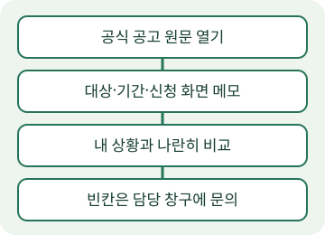

<!-- 가상 연습용: 수아의 가상 블로그 ‘퇴근 후 생활 정보’. 실제 제도·신청 자격·혜택 안내가 아닙니다. -->
# 청년 직장인 지원 제도, 신청 전에 어디부터 볼까

지원 제도를 찾았다면 신청 버튼보다 공식 공고의 대상과 기간부터 확인하세요. 요약 글은 후보를 찾는 데 쓰고, 내가 신청할 수 있는지는 운영 기관의 공고와 신청 화면을 맞춰 보세요. 이 글은 ‘퇴근 후 생활 정보’라는 가상 블로그의 편집 연습 글입니다. 특정 제도나 금액을 안내하지 않습니다.

## 공고를 찾으면 대상과 신청 상태를 나눠 읽으세요

검색 결과의 짧은 설명만으로 내 조건에 맞는다고 판단하기 쉬워요. 먼저 운영 기관이 올린 원문을 열고 제도 이름과 담당 창구를 적어 두세요. 원문을 찾지 못했다면 신청 링크부터 누르기보다 운영 기관의 공지 목록에서 같은 제목을 찾아보세요.

대상란에서는 나이뿐 아니라 거주지와 재직 상태처럼 내 상황과 관계있는 항목을 따로 적으세요. 조건을 읽는 일과 신청이 열려 있는지 확인하는 일은 나눠 두면 좋아요. 저장해 둔 공고가 있어도 접수 화면의 현재 상태는 다시 확인하세요.

- 제도 이름과 운영 기관: 검색 글에서 본 이름과 공식 공고의 이름이 같은지 확인해요.
- 대상과 제외 조건: 해당하는 문장을 옮겨 적고 내 상황과 나란히 놓아요.
- 접수 기간과 제출 방법: 지금 열려 있는 신청 화면에서 다시 확인해요.
- 문의할 내용: 내 상황을 공개 댓글에 쓰기보다 담당 창구에 물어볼 질문으로 남겨요.

## 내 경험: 링크만 모으니 다음 행동이 안 보였어요

아래는 가상 인물 수아의 편집 연습 메모입니다. 실제 체험담으로 옮겨 쓰지 마세요.

저는 퇴근 후 읽으려고 링크만 저장해 뒀어요. 나중에 다시 열었을 때 무엇을 확인하려 했는지 기억이 흐려졌어요. 그래서 이번 메모에는 링크 옆에 ‘내 거주 조건을 어디에서 확인할까’처럼 질문을 붙였어요. 아직 답을 찾지 못한 항목은 빈칸으로 남겼어요.

내 글에서는 이 문단을 본인이 실제로 찾아보고 헷갈렸던 내용으로 바꾸세요. 신청을 하지 않았다면 신청해 봤다고 쓰지 않고, 공고를 확인한 과정만 적어도 됩니다. 직접 찍은 화면을 넣을 때는 이름과 연락처 등 개인정보를 먼저 가리세요.

## 지금 할 일: 후보 공고를 하나 골라 메모하세요

오늘은 관심 있는 제도의 공식 공고를 열고 ‘운영 기관 / 원문 주소 / 확인한 날짜 / 내 조건 / 문의할 질문’을 적어 보세요. 지원 금액이나 마감일을 글에 쓸 때는 근거 문장과 확인일도 함께 남기세요. 확인되지 않은 내용은 비워 두고 담당 기관에 물어본 뒤 채우세요.

### 자주 묻는 질문

**내가 받을 수 있는 제도를 이 글에서 고를 수 있나요?** 이 글은 공고를 읽는 연습용입니다. 본인의 조건과 현재 공고를 직접 대조해 고르세요.

**공식 공고를 못 찾았으면 어떻게 하나요?** 운영 기관의 공지 목록과 문의 창구에서 확인하세요. 찾지 못한 자격이나 금액을 AI에게 채워 달라고 하지 마세요.
